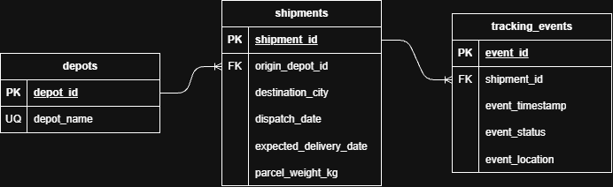

# 📦 ParcelFlow ETL Pipeline

## Overview

ParcelFlow is a fictional UK parcel delivery company operating across three depots: Belfast, Manchester and Birmingham. Each depot generates daily CSV exports containing shipment information and parcel tracking events.

This project involves designing and developing a Python-based ETL pipeline to consolidate these datasets into a centralised PostgreSQL database.

## Business Problem

Shipment and tracking data is currently stored in separate depot-level CSV files, making it difficult to analyse delivery performance across the business.

ParcelFlow needs a reliable process to extract, clean, validate and consolidate this data to support operational reporting, including shipment statuses, delivery times, delays and depot performance.

## Tech Stack

- **Python** - CSV extraction, transformation and data validation
- **Pytest** - Automated unit testing
- **PostgreSQL** - Target relational database (planned)
- **Docker** - Containerised database environment (planned)
- **AWS** - Future cloud-based ingestion and orchestration

## Pipeline Architecture

The pipeline follows an Extract, Transform, Load (ETL) approach:

1. **Extract:** Read daily CSV exports from the three depots.
2. **Transform:** Standardise field values, validate tracking records,
   remove duplicate events and identify conflicting data.
3. **Load (planned):** Persist the processed data into PostgreSQL
   using the relational data model.

The initial implementation focuses on local CSV processing and
data quality. Future iterations will introduce database loading
and cloud-based ingestion.

## Data Model

The relational model consists of three tables:


| Table name | Description |
|------------|-------------|
| `depots` | Depot information |
| `shipments` | Individual shipment details |
| `tracking_events` | Shipment tracking history |



## Data Quality

The transformation layer includes checks for malformed timestamps,
invalid parcel weights, unsupported tracking statuses and duplicate
tracking events.

Conflicting records sharing the same event ID are identified and
returned separately for further investigation.

See the [Data Quality Rules](docs/data-quality-rules.md) for
implemented checks, known limitations and planned improvements.

## Testing

Automated unit tests are written using Pytest and cover extraction,
standardisation, validation, deduplication and conflict detection.

Run the test suite from the project root:

```bash
python -m pytest -v
```

